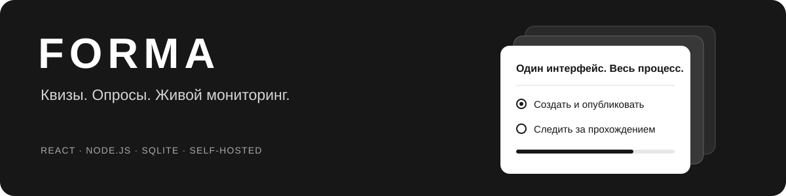
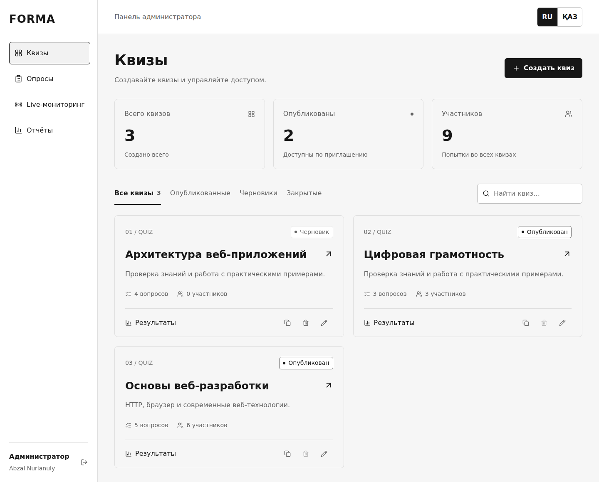
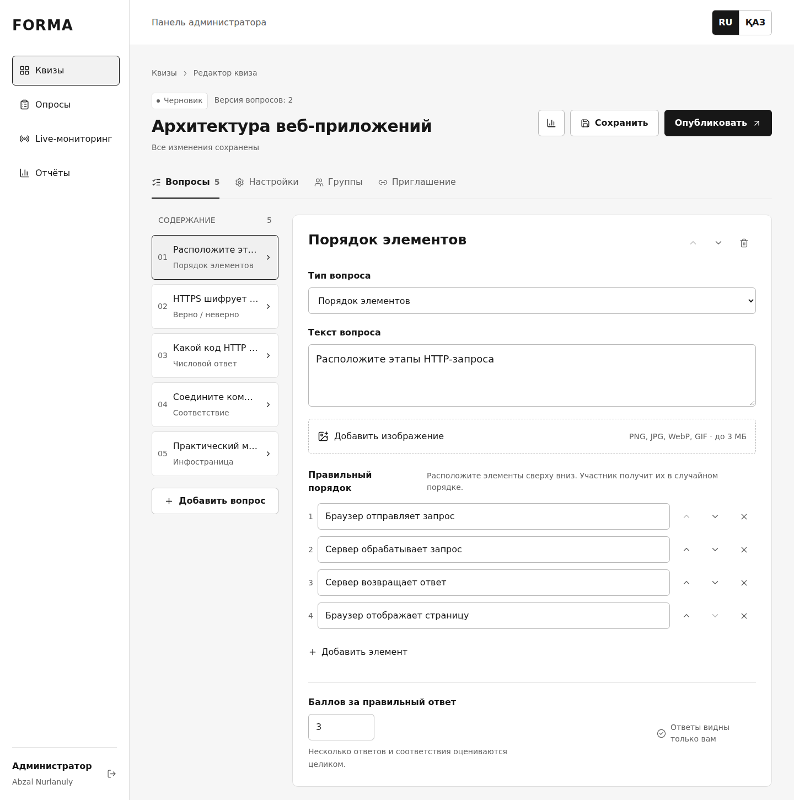
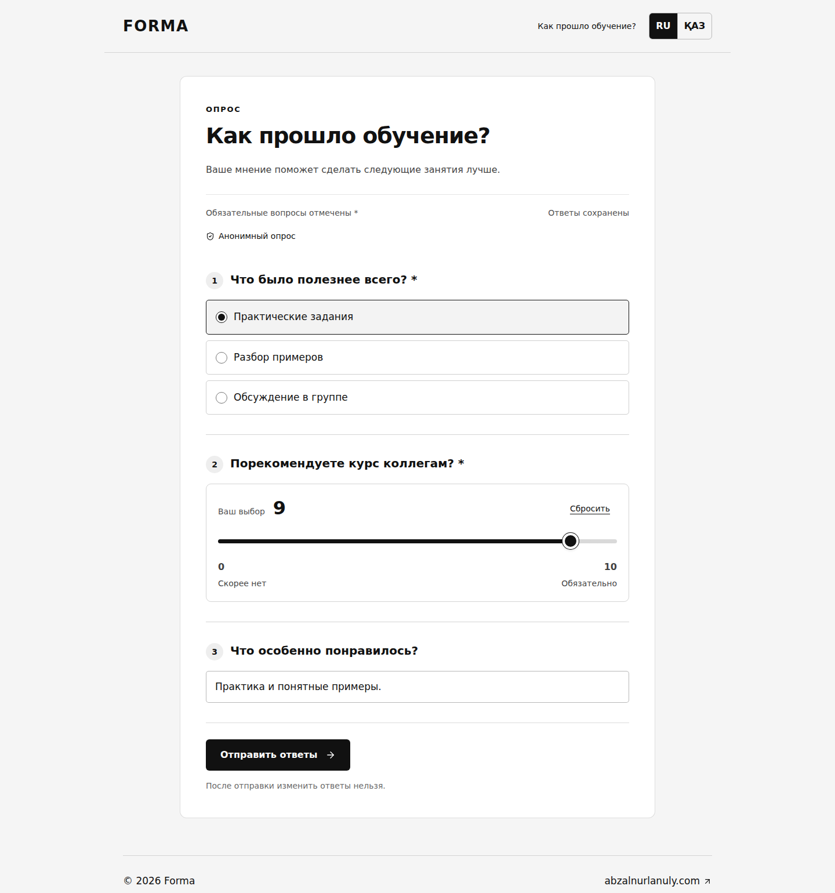
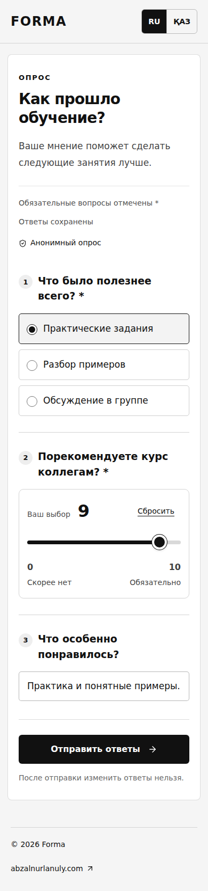
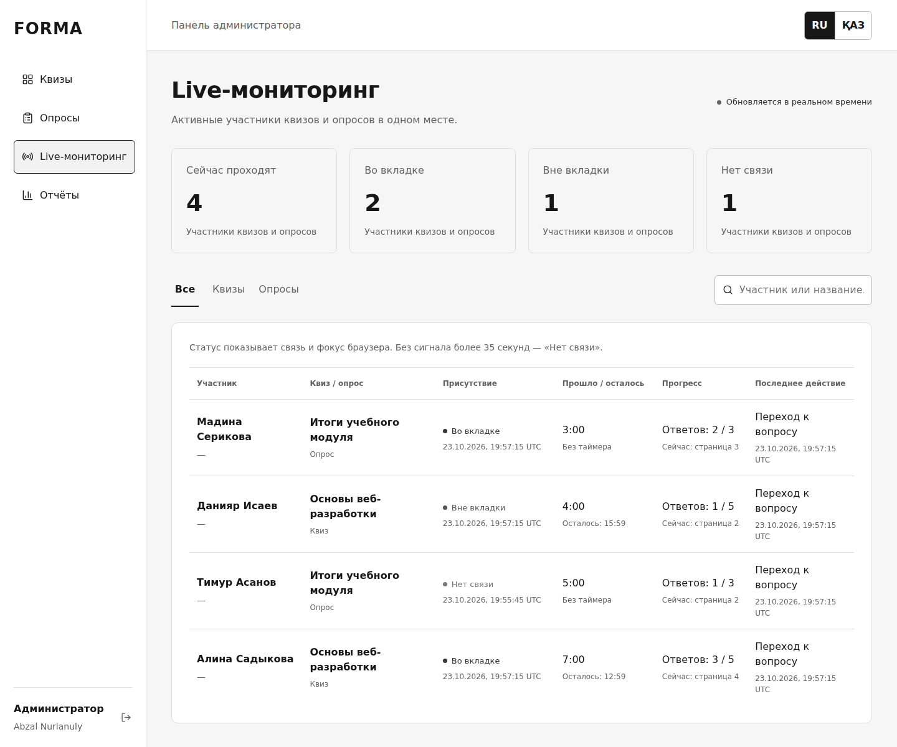
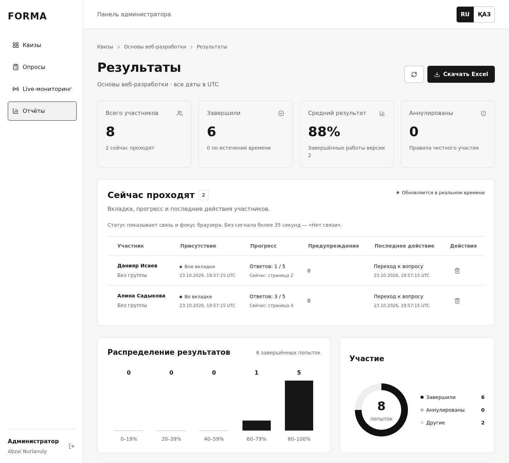
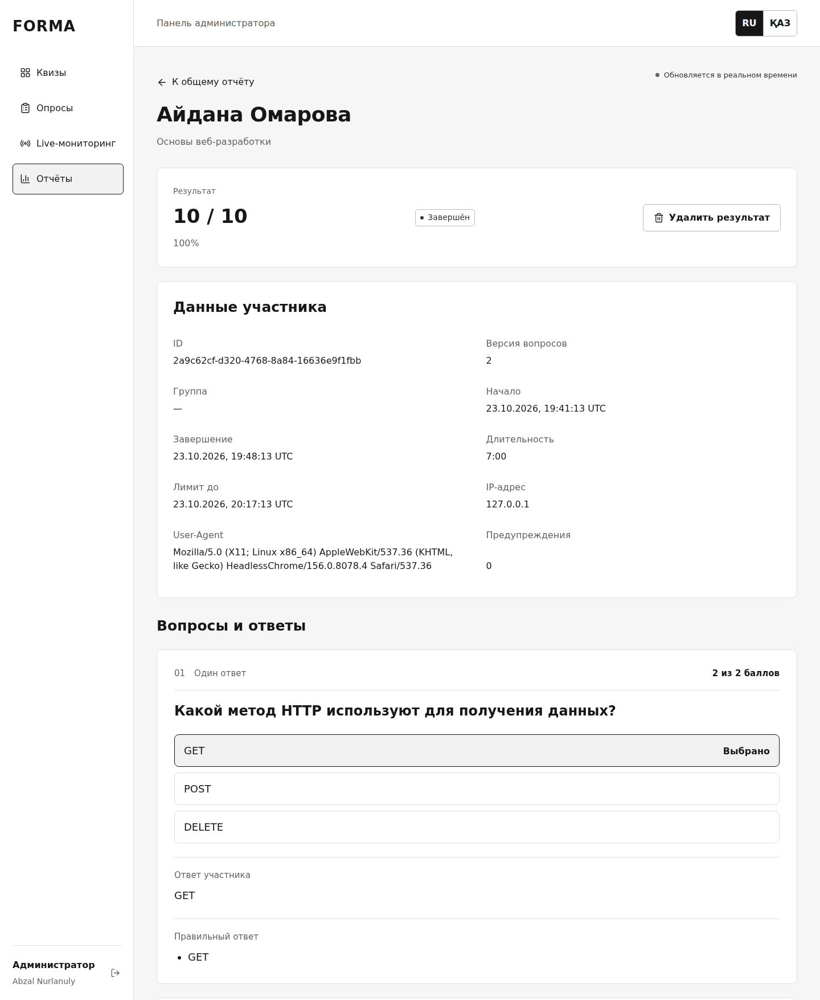
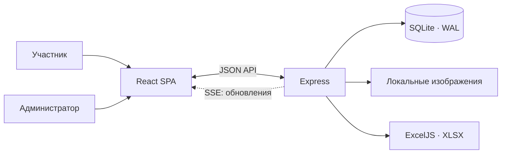

<p align="center">
  
</p>

<p align="center">
  Платформа для тестирования и обратной связи с собственным хранением данных.
  <br />
  Создание форм, прохождение, мониторинг и отчёты — в одном SPA.
</p>

<p align="center">
  <a href="https://quiz.abzalnurlanuly.com">Открыть приложение</a> ·
  <a href="#быстрый-старт">Быстрый старт</a> ·
  <a href="docs/DEPLOYMENT.md">Развёртывание</a> ·
  <a href="CONTRACT.md">Контракт API</a>
</p>

<p align="center">
  <code>React 19</code>&nbsp;
  <code>Node.js 24</code>&nbsp;
  <code>Express 5</code>&nbsp;
  <code>SQLite</code>&nbsp;
  <code>Docker</code>&nbsp;
  <code>RU / ҚАЗ</code>
</p>



## Возможности

| Раздел | Что умеет |
| --- | --- |
| **Квизы** | Одиночный и множественный выбор, короткий ответ, сопоставление, «верно / неверно», число с погрешностью, порядок элементов и информационные страницы. Оценивание на сервере. |
| **Опросы** | Десять форматов полей, обязательные ответы, выпадающие списки, рейтинг, ползунок, даты. Логотип, обложка, цвета, шрифт и ширина формы. |
| **Редактирование** | Вопросы и настройки меняются после публикации и сдач. Новые участники получают новую версию, начавшие сохраняют свою. Старые ссылки продолжают работать. |
| **Live** | Активная или скрытая вкладка, потеря связи, текущий вопрос, сохранённый прогресс, время и действия участников. Обновления через SSE. |
| **Отчёты** | Индивидуальные SPA-страницы с вопросами, ответами и журналом. Статистика по версиям, два вида Excel с диаграммами. |
| **Доступ и приватность** | Группы, личные коды, пересдачи, необязательные ограничения IP/браузера. Анонимные опросы и отдельные настройки сбора метаданных. |

Правильные ответы после теста **скрыты по умолчанию**. Показ баллов, разбор после завершения и немедленная проверка вопроса настраиваются отдельно.

## Интерфейс

### Редактор квиза

Вопросы можно добавлять, менять, переставлять и удалять без обязательного создания копии. У разных форматов — собственные элементы ввода и правила проверки.



### Опрос на компьютере и телефоне

Настраиваемое оформление, читаемые поля, разделители вопросов и шкала с явным выбором значения. Ответы сохраняются автоматически, незавершённую анкету можно продолжить в своём браузере.

<table>
  <tr>
    <td width="74%" valign="top"></td>
    <td width="26%" valign="top"></td>
  </tr>
</table>

### Мониторинг участников

Квизы и опросы отображаются в общем разделе. По участнику можно перейти к подробному отчёту, не перезагружая приложение.



<details>
<summary>Общий отчёт: сводка и распределение результатов</summary>



</details>

### Индивидуальный отчёт

Каждая работа имеет отдельный адрес: сохранённые вопросы и варианты, ответы, баллы квиза, время и журнал. Отчёт остаётся корректным после редактирования формы.



<sub>Все скриншоты сделаны на отдельной демонстрационной базе с вымышленными участниками и ответами.</sub>

## Как устроено



Один Node.js-процесс обслуживает API и собранный клиент на одном origin. SQLite хранит формы, работы, события и сессии; изображения находятся в каталоге данных. Внешняя БД и облачное хранилище для запуска не нужны.

Три решения, на которых держится поведение приложения:

- **Версия вопросов фиксируется при старте.** Изменение ключа, текста или типа вопроса влияет на будущие работы. Старые ответы оцениваются по сохранённой версии; статистика разных версий не смешивается.
- **Сервер определяет результат.** Клиент отправляет ответы и события, а API проверяет варианты, обязательность, сроки и доступ. Чужую работу нельзя открыть по одному ID.
- **Экспорт разделён по составу данных.** Публичный Excel содержит вопросы, варианты, участников, результаты и журнал, но не ответы и ключи. Приватный дополняет его ответами, метаданными и историей пересдач. Длинные варианты и составные ответы сохраняются отдельными строками.

Пароли хешируются scrypt, доступ администратора использует сессии и HttpOnly-cookie, изменяющие запросы защищены проверками origin и специального заголовка. Анонимность и сбор имени/IP/User-Agent задаются отдельно для каждого опроса.

## Быстрый старт

Нужны **Node.js 24.15+ из ветки 24** и **pnpm 11.25.0**. Выполняйте команды из каталога проекта.

```bash
pnpm install --frozen-lockfile
```

```bash
pnpm build
```

Запустите локальную демонстрацию. Веб-создание первого администратора разрешено здесь только для локального HTTP:

```bash
APP_ORIGIN=http://127.0.0.1:7272 SECURE_COOKIES=false ALLOW_SETUP=true SEED_DEMO=true HOST=127.0.0.1 PORT=7272 pnpm start
```

Откройте **http://127.0.0.1:7272/admin** и создайте свою учётную запись. Готового логина или пароля в репозитории нет. `SEED_DEMO=true` добавляет демонстрационный квиз в пустую базу.

Для примеров всех десяти полей опроса выполните в другом терминале:

```bash
node scripts/create-test-survey.js
```

Скрипт создаёт анонимный черновик с тестовыми подписями. Повторный запуск не создаёт дубликат. Данные локального запуска хранятся в `data/`, который исключён из Git.

Для Docker, публичного HTTPS, CLI администратора, резервных копий и восстановления — [руководство по развёртыванию](docs/DEPLOYMENT.md).

## Проверки

```bash
pnpm test
```

В текущей версии **75 серверных тестов**: настоящие HTTP-запросы и отдельные временные SQLite-базы. Проверяются оценивание, скрытие ответов, права доступа, CSRF, конкурирующие старты, дедлайны, нормализация IPv4/IPv6, версии, старые ссылки, пересдачи, анонимность и содержимое XLSX.

Интерфейс дополнительно проверен в Chromium на ширинах 320–1440 px: мобильные шапки и вкладки, прокрутка окон, шкала с нулевым значением, автосохранение и переходы между SPA-страницами. Это не заменяет испытаний на физических устройствах или нагрузочного тестирования.

## Структура проекта

```text
client/                 React: редакторы, прохождение, live, отчёты, RU/KK
server/                 Express API, модель, SQLite, изображения и Excel
scripts/                Backup/restore и тестовый опрос
server/admin-cli.js     Создание администратора и сброс пароля
tests/                  Интеграционные проверки и фикстуры
docs/DEPLOYMENT.md      Запуск и обслуживание
docs/assets/            Обложка и скриншоты
CONTRACT.md             Данные, маршруты и правила API
compose.yaml            Контейнер с постоянным volume
```

## Ограничения

Проект рассчитан на один экземпляр приложения с SQLite. Горизонтальные реплики с общей базой не поддерживаются. Docker запускает процесс без root, с файловой системой только для чтения и ограничением ресурсов; каталог данных сохраняется в отдельном volume.

Браузерный контроль фиксирует сигналы вкладки, а не доказывает физическое присутствие и не обнаруживает второе устройство. Один IP может принадлежать целой аудитории; cookie можно удалить. Эти ограничения включаются по ситуации, а не заменяют проверку личности.

Публичный Excel означает **«без ответов»**, а не «без персональных данных»: если сбор включён, файл может содержать имена и IP. `.env`, рабочие базы, загрузки, выгрузки и резервные копии исключены из Git.

---

Автор — [Abzal Nurlanuly](https://abzalnurlanuly.com).
